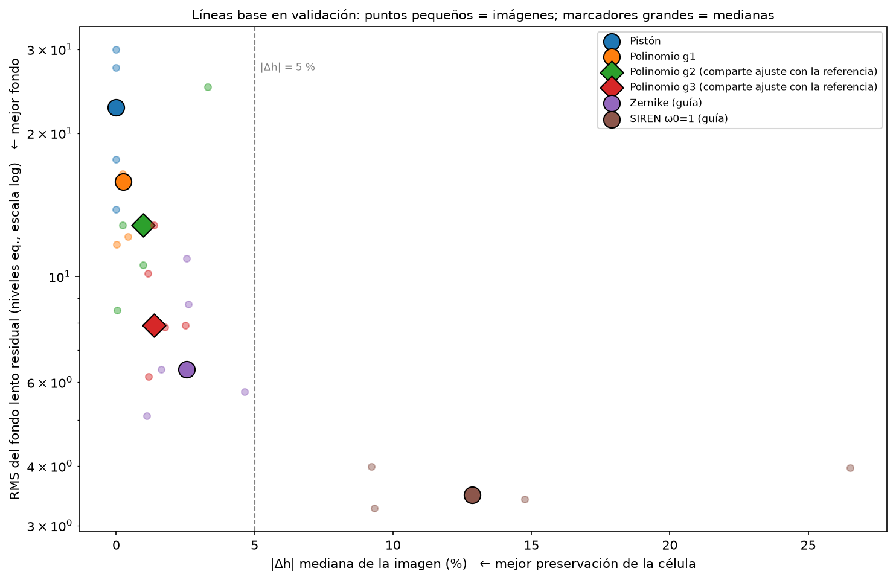

# EritroFase: corrección del fondo en imágenes de fase de eritrocitos mediante redes neuronales informadas por la física

Informe final · SI3014 Redes Neuronales y Aprendizaje Profundo · Universidad EAFIT · 2026-2
Grupo 1: Juan José Escobar, Emmanuel Hernández, Mateo Lopera · 11 de noviembre de 2026

## 1. Objetivos

En la microscopía holográfica digital, la fase de cada célula se mide respecto a un **fondo** que no es cero: la inclinación del haz de referencia y las aberraciones ópticas lo introducen. Como la altura, el volumen y la masa seca se calculan respecto a ese nivel, un fondo sin corregir sesga todas las medidas cuantitativas de la célula. El problema consiste en separar el fondo de la célula, lo cual no tiene solución única sin supuestos físicos. Los métodos clásicos ajustan polinomios de baja frecuencia y deben excluir las células [5, 6]; una red informada por la física puede entrenarse sin etiquetas [7].

**Objetivo general.** Estimar y compensar el fondo en imágenes de fase de eritrocitos con una red neuronal informada por la física, reduciendo el fondo residual y preservando el perfil de fase de las células.

**Objetivos específicos.** (1) Fundamentar las representaciones neuronales implícitas con activaciones sinusoidales y su relación con la codificación de Fourier, para definir arquitectura y restricciones. (2) Caracterizar y seleccionar imágenes del dataset, con conjuntos de desarrollo y evaluación sin fuga de información. (3) Validar la reducción del fondo y la conservación de la célula con métricas y perfiles, sin una verdad de fondo conocida.

## 2. Base de datos y preprocesamiento

**Origen.** Castañeda et al. [1] publicaron hologramas de eritrocitos humanos adquiridos con un DHM fuera de eje, láser de 532 nm y objetivo 40×/0,65 NA. Los PNG de fase son de 8 bits y 256×256 píxeles. El inventario muestra 12.288 recortes distintos, cada uno en tres variantes (base, `-A` y `-B`, volteos exactos), que provienen de 192 adquisiciones. Los cuatro campos de una adquisición son la misma escena rotada 90°, 180° y 270°.

**Fuga en la partición original.** Los conjuntos `Training` y `Validation` comparten 5.837 recortes (47,5 %), de modo que evaluar con ellos mediría desempeño sobre escenas ya vistas. Por eso la partición se hizo **por adquisición**. De 40 candidatas del filtro automático se curaron 22 imágenes del 29/01/2021, que se dividieron de forma estratificada por el nivel de fondo (semilla 42) en 12 de entrenamiento, 5 de validación y 5 de prueba. Las 8 imágenes de generalización provienen de tres adquisiciones del 28/01/2021 (otro día) y se eligieron por defectos visibles. No hay adquisiciones compartidas entre conjuntos. Una prueba de contenido (rotación, volteo y desplazamiento, todas contra todas) dio una similitud máxima de 0,9845 entre conjuntos distintos, frente a 1,0000 del control positivo.

**Preprocesamiento.** Se interpreta el gris como fase envuelta escalada linealmente, $\varphi = 2\pi g/255 - \pi$. Los datos son consistentes con esta hipótesis, pero el dataset no trae calibración, así que la escala absoluta en radianes no está verificada. Cada imagen se desenvuelve con el algoritmo de Herráez et al. [2], se invierte el signo (en la reconstrucción las células quedan por debajo del fondo) y se expresa en niveles de gris equivalentes, $u = -\tfrac{255}{2\pi}\,\mathcal U(2\pi g/255 - \pi)$. El desenvolvimiento es reversible: la fase envuelta se recupera exactamente en las 30 imágenes de desarrollo y generalización. Quedan como máximo dos saltos residuales por imagen en entrenamiento, ninguno en validación y prueba, y hasta 13 pares de píxeles en generalización.

**Límites de los datos.** Son 5 imágenes de validación y 5 de prueba, con 12 células evaluables en validación. Las máscaras de referencia son umbrales aproximados, y no existe una verdad de fondo.

## 3. Modelo

**Arquitectura.** Se usa una representación neuronal implícita por imagen [3, 4]: una red SIREN con entrada $(x,y)$ normalizada a $[-1,1]^2$, una capa senoidal de frecuencia $\omega_0 = 1$, dos capas ocultas de 128 neuronas y una salida lineal que estima el fondo en niveles equivalentes. Tiene 33.537 parámetros. Se eligió porque la frecuencia controla de forma explícita el ancho de banda del fondo, y porque el código guía del curso [8] ya la implementa como línea base.

**Pérdida.** Con $r = u - \hat b$, la pérdida combina tres términos. (i) Error absoluto medio sobre el 70 % de los píxeles con menor $|r|$; el 30 % restante, donde suele estar la célula, no entra en el término (esparsidad, S2). (ii) Penalización cuadrática de los residuos negativos, con peso 0,8, y lineal de los positivos, con peso 0,008, que impide que el fondo absorba la célula (signo, S3). (iii) Término $0{,}1\,\operatorname{mediana}(r)^2$, que fija el nivel del fondo cerca de cero (referencia, S4). La suavidad (S1) se impone con la baja frecuencia de la red; un laplaciano explícito se probó y no mejoró el compromiso.

**Entrenamiento y selección.** Cada imagen se ajusta de forma independiente con Adam (tasa $10^{-3}$) durante 1.000 iteraciones fijas, sin parada temprana y sin usar máscaras. Los hiperparámetros se eligieron en validación entre 59 configuraciones de este esquema. La semilla se escogió con la regla fijada de antemano, el menor M1 mediano admisible en validación (semilla 2024). Como control de robustez se repitió con las semillas 42 y 12345. El equipo fue una GPU NVIDIA RTX 3060 (12 GB), PyTorch 2.14.0 con CUDA 12.6 y 16 núcleos lógicos de CPU. El ajuste tardó 7,47 s por imagen y la inferencia 0,003 s, en medición controlada sobre validación.

**Alternativas descartadas.**
- *Encoder amortizado (C):* predice coeficientes con un promedio global que descarta la posición espacial; M1 de 19,52 niveles.
- *Descomposición fondo-célula (D):* la rama celular colapsa; M1 de al menos 26,0 niveles, y sus implementaciones tuvieron errores de lote.
- *Mínimos cuadrados ponderados (E):* M1 de 8,63 ± 0,87 en validación, peor que Zernike.
- *Ajuste implícito con pesos de E (AE):* M1 de 6,16 ± 0,09 y $|\Delta h|$ de 4,97 %, prácticamente igual a A, con una segunda red de 150.930 parámetros.

## 4. Resultados

**Tabla 1.** Medianas en el conjunto de prueba (5 imágenes) frente a las líneas base, y de A en generalización. M1 en niveles equivalentes (ideal 0; piso por ruido ≈ 0,5). $\Delta h$ es el cambio relativo de la altura local de la célula (ideal 0).

| Método | M1 | $\Delta h$ (%) | $\lvert\Delta h\rvert$ (%) | Dice | $\lvert\Delta h\rvert \le 5\,\%$ |
|---|---:|---:|---:|---:|:---:|
| Pistón | 18,18 | 0,00 | 0,00 | 0,971 | Sí |
| Polinomio grado 3 | 10,37 | −0,83 | 1,19 | 0,967 | Sí |
| Zernike (guía) | **6,49** | −2,94 | 2,94 | 0,970 | Sí |
| SIREN $\omega_0=1$ (guía) | 4,22 | −12,27 | 12,27 | 0,943 | No |
| **A (propuesto)** | 7,10 | −4,81 | 4,81 | 0,970 | Sí |
| A, otro día (8 imágenes) | 11,79 | −2,07 | 2,07 | 0,941 | — |

**Criterio de éxito** (fijado antes de entrenar). (1) Preservación: $|\Delta h|$ mediana $\le 5\,\%$. Se cumple con 4,81 %. (2) Fondo: M1 no mayor que el de la mejor línea base admisible, que es Zernike con 6,49. **No se cumple**: A obtiene 7,10. (3) Consistencia: A supera a Zernike en ambas métricas a la vez en **0 de 5** imágenes de prueba. El modelo **no cumplió el criterio de éxito en prueba**, y la hipótesis correspondiente se rechaza.

**Compromiso fondo-célula.** En validación, A dejó un fondo algo menor que Zernike (6,18 ± 0,18 frente a 6,39 niveles, diferencia comparable a la dispersión entre semillas), a costa de más altura perdida (4,16 ± 0,56 % frente a 2,55 %; Figura 1). En prueba desapareció la ventaja de fondo (7,10 frente a 6,49) y el cambio de altura se acercó al límite de 5 %. Este patrón es coherente con un sobreajuste de la selección sobre las mismas 5 imágenes de validación, que se usaron para escoger entre 59 configuraciones. La SIREN del código guía muestra el mismo compromiso de forma extrema: deja el fondo más plano (4,22 niveles) pero absorbe 12,27 % de la altura celular.

{w=8.2cm}

**Generalización.** En el otro día la mediana de M1 sube a 11,79 niveles y la de $|\Delta h|$ baja a 2,07 %. El conjunto mezcla día de adquisición, calidad y selección (8 imágenes de 3 escenas), y Zernike no se evaluó allí. Por eso la diferencia no se atribuye al modelo.

## 5. Conclusiones

**Cumplimiento de los objetivos.** El objetivo específico 1 se cumple con la fundamentación de SIREN, Fourier y las restricciones físicas de la pérdida. El específico 2 se cumple: la partición original tiene fuga demostrada y la partición por adquisición la evita. El específico 3 se evaluó con métricas y perfiles, y el resultado es negativo en prueba. El objetivo general **no se alcanza** con el criterio fijado: A preserva la célula ($|\Delta h|$ de 4,81 %), pero no reduce el fondo lento residual por debajo de Zernike (7,10 frente a 6,49 niveles).

**Limitaciones.**
- Solo 5 imágenes de validación y 5 de prueba, con alta varianza. Los resultados son consistentes con una tendencia y no demuestran una mejora.
- Los hiperparámetros se seleccionaron en validación. Las líneas base no recibieron una búsqueda equivalente.
- En la primera ejecución se calcularon métricas de prueba en puntos intermedios del ajuste. No se usaron para decidir, pero el protocolo no fue estrictamente una única evaluación; las predicciones finales se recuperaron de caché (notebook, sección 9.1).
- Sin verdad de fondo, las máscaras son aproximadas y las métricas dependen de ellas.
- Los errores de lote de C y D impiden concluir sobre esas arquitecturas.
- El coste no es comparable: A se midió de forma controlada en validación (7,47 s por imagen), mientras que Zernike (2,58 s) se midió en prueba completa.

**Trabajo futuro.** Ampliar el número de adquisiciones, contrastar con referencias físicas o simulaciones con valores conocidos, reevaluar C y D tras corregir los errores de lote, y estudiar la sensibilidad a las máscaras y al ruido.

## Referencias

[1] R. Castañeda, C. Trujillo y A. Doblas (2024). A human erythrocytes hologram dataset for learning-based model training. *Data in Brief*, 54, 110424.
[2] M. A. Herráez, D. R. Burton, M. J. Lalor y M. A. Gdeisat (2002). Fast two-dimensional phase-unwrapping algorithm based on sorting by reliability following a noncontinuous path. *Applied Optics*, 41(35), 7437–7444.
[3] V. Sitzmann, J. N. P. Martel, A. W. Bergman, D. B. Lindell y G. Wetzstein (2020). Implicit neural representations with periodic activation functions. arXiv:2006.09661.
[4] M. Tancik et al. (2020). Fourier features let networks learn high frequency functions in low dimensional domains. arXiv:2006.10739.
[5] J. Tang et al. (2023). Phase aberration compensation via a self-supervised sparse constraint network in digital holographic microscopy. *Optics and Lasers in Engineering*, 168, 107671.
[6] Z. Huang y L. Cao (2023). Phase aberration separation for holographic microscopy by alternating direction sparse optimization. *Optics Express*, 31(8), 12520–12533.
[7] D. Xu, L. Cao y H. Sun (2025). Adaptive aberration-corrected quantitative phase microscopy via physics-informed deep learning. *Advanced Photonics*, 7(6), 066013.
[8] Código guía del curso (`compensate_background`, `compensate_background_zernike`), incorporado en el notebook EritroFase.
